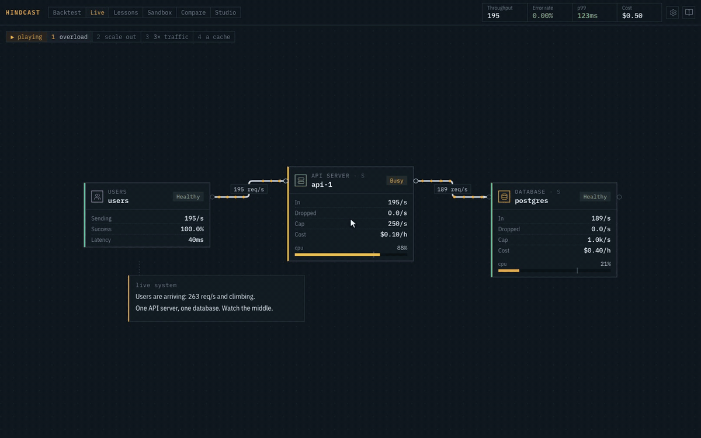
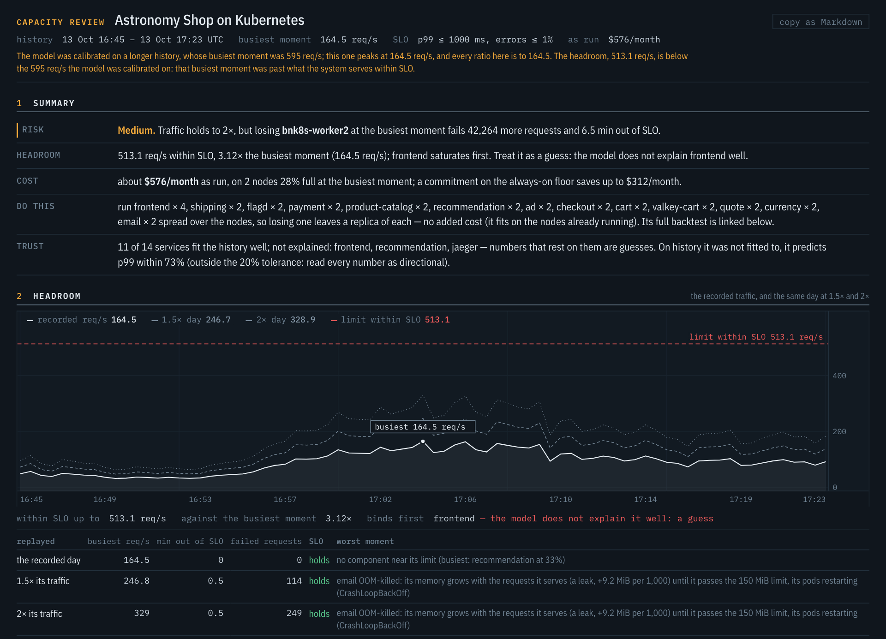
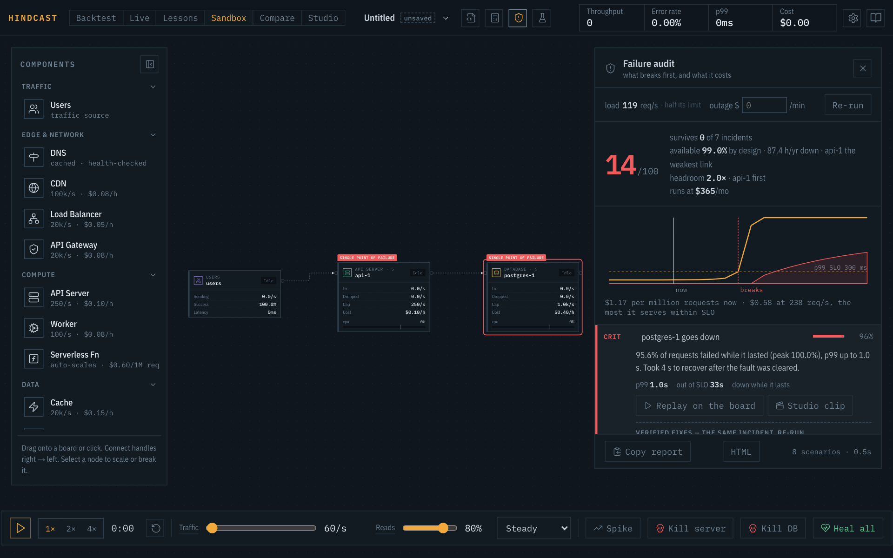
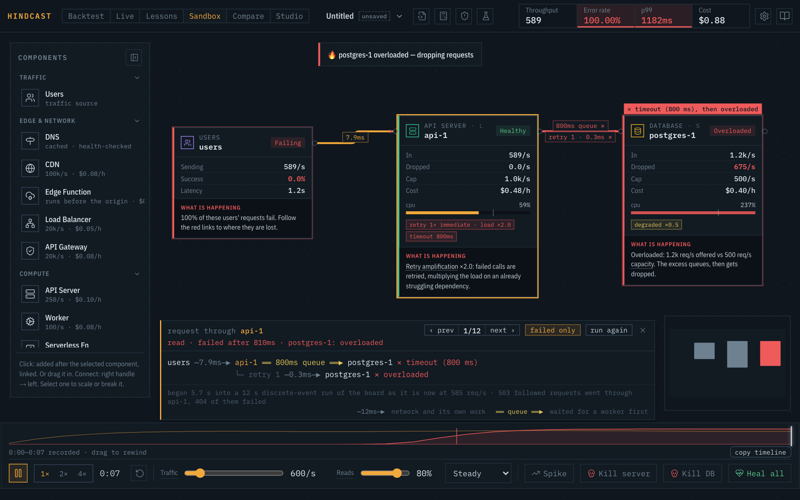

# Hindcast

**Backtest infrastructure changes on your real telemetry before they ship.**

Replay a resize, an autoscaler, a cache, a retry policy or a Kubernetes diff over the traffic you
actually had. Hindcast says what it would have cost in dollars and in minutes out of SLO, and how
far to trust that. It only reads from your systems and runs on your machine.

[](LICENSE)
[](https://github.com/votiakov/hindcast/releases/latest)
[](https://github.com/votiakov/hindcast/actions/workflows/ci.yml)
&nbsp; [Install](docs/install.md) · [Docs](docs/README.md) · [Accuracy](reference/k8s/README.md) ·
[For agents](docs/agents.md) · [Why Hindcast](docs-site/pages/why.html)

```sh
hindcast quickstart --prometheus http://localhost:9090    # a capacity review of what it finds
```

No Prometheus to point it at? [Open the recorded reference systems](#no-cluster-handy) instead.



<sub>A recorded day of the OpenTelemetry Astronomy Shop, replayed at 2× its traffic. As built it
breaks as the traffic climbs and spends 24 minutes out of SLO; autoscaling the frontend removes 23
of them for $28 a month more. [Full video, 24 s](docs/media/app-backtest.mp4), with the Review
screen.</sub>

## Try it

Point it at a Prometheus. One command connects, collects the history (the last 24 hours by
default), calibrates a model and writes a capacity review:

```sh
hindcast quickstart --prometheus http://localhost:9090 --jaeger http://localhost:16686 --last 24h
```

The review opens with five lines: risk, headroom, cost, the one change worth making, and how far to
trust it. Traces (`--jaeger` or `--tempo`) are optional; without them, who calls whom comes from
Istio, Linkerd, the OpenTelemetry service graph or span metrics, and the review says what it's
missing.

On Datadog instead of Prometheus:

```sh
hindcast quickstart --datadog datadoghq.com --last 24h   # keys read from DD_API_KEY and DD_APP_KEY
```

It reads APM trace metrics, the Agent's Kubernetes metrics and ingress-nginx through the Metrics
API, and who calls whom from APM service dependencies. So far it has been tested against a mock
built from Datadog's API documentation, not a live account ([details](docs/agents.md#datadog)).

`hindcast` is a single binary with no runtime. Download it from the
[latest release](https://github.com/votiakov/hindcast/releases/latest) (macOS, Linux, Windows):

```sh
curl -fsSLo hindcast https://github.com/votiakov/hindcast/releases/latest/download/hindcast-aarch64-apple-darwin
chmod +x hindcast
./hindcast demo    # a recorded system built into the binary: no network, no files
```

`demo` runs on the OpenTelemetry Astronomy Shop recorded under load: the capacity review (including
losing a node), four strategies backtested over the recorded day, and how the model did on runs it
never saw. `./hindcast demo --workspace ./hindcast-demo` writes that data to disk so every other
command runs on it.

Other platforms, building from source and the app: [docs/install.md](docs/install.md).

### No cluster handy

`hindcast demo` needs only the binary. The other recorded reference systems ship with the
repository, so you can see real output with no infrastructure at all.

```sh
git clone --depth 1 https://github.com/votiakov/hindcast.git && cd hindcast
npm install && npm run dev      # app on http://localhost:5173, Backtest tab
```

The Backtest tab opens on HotROD; its system picker switches to the Astronomy Shop, PetClinic and
the shop on Kubernetes. Or stay in the terminal and run the committed models through the CLI:

```sh
hindcast backtest reference/shop/model.json reference/shop/dataset.json \
  reference/shop/strategies/1-autoscale-frontend.yaml reference/shop/strategies/3-graviton.yaml
hindcast accuracy reference/shop/model.json        # how it did on runs it never saw
hindcast outage   reference/shop/model.json list   # public outages to replay against it
```

These models come from 40-minute runs of demo systems. They show what the output looks like, not
numbers about your system.

## What it answers

**Would this change have held?** Give it a strategy (replicas, CPU and memory, an HPA, a cache, a
retry budget, an instance family), a Kubernetes diff or a Terraform plan. It replays the change
over the recorded history and reports dollars saved or spent, minutes out of SLO, failed requests,
and the worst moment and why, with confidence bands. Famous public outages replay against your
model too. As a pull-request check, it fails the build when a change adds time out of SLO.

**What does our cluster need?** On Kubernetes it reads what the cluster already exports
(kube-prometheus-stack, ingress-nginx, OpenTelemetry) and covers the questions a platform team
answers by hand: CPU quota throttling that caps a service before its limit, memory limits that
would OOM-kill pods, whether a request cut actually removes a node, and what losing one node or
zone at the busiest moment takes down.



**What breaks first, and what does it cost?** Draw a system, import it from Terraform or
Kubernetes manifests, or paste a YAML spec. The failure audit kills every component, slows every
dependency, restarts every cache cold and darkens every zone, grades each incident by what users
would have seen, and re-runs the same incident to verify and price each fix per month.



**Where does a request go wrong?** The simulator has two engines written in Rust: a fluid model
fast enough for a live board, and a discrete-event one that simulates every request, so retry
storms and timeouts emerge instead of being assumed. Trace any request hop by hop.



## How far to trust it

The accuracy record is in the repository, misses included, and the committed data regenerates
every table from a clone. The main study runs the OpenTelemetry Astronomy Shop on a kind cluster
(Kubernetes in Docker) on one laptop, with k6 (a load generator) replaying the arrival curve of
NASA's July 1995 web log; a second system, Spring PetClinic, checks the model on a system it was
not shaped on. A verdict is pass, fail or inconclusive: inconclusive is the model
saying the change goes past what the history showed, and to load-test it instead.

| check | result |
|---|---|
| Out of sample, Astronomy Shop: 9 runs, each verdict committed before the run was recorded | 3 right, 1 wrong, 5 inconclusive |
| Out of sample, PetClinic: 9 runs in two rounds, committed the same way | 5 right, 1 wrong, 3 inconclusive. The miss, in round 1, was a JVM whose halved CPU limit never let it finish warming up, a cold start the model didn't know about. It learned JIT warm-up, and in round 2 it was never wrong, but it hedged on 2 of 3 changes that passed. Today's code (2026-10-17, in sample): with the cold-capacity check a warning instead of a reason to hedge, one of those hedges becomes a right pass and round 1's ordinary-day CPU cut a wrong one |
| A plain CPU-ratio rule on the same 18 runs | 14 right, 4 wrong |
| In sample: 5 decisions from an ordinary day (the throttle rules were designed on these) | 4 right, 1 wrong |
| p99 on each day's own traffic within 20% of measured | Shop: 3 of 14 runs, it underestimates busy days. PetClinic: 0 of 6, 14 ms predicted against 7–9 ms measured on healthy days. Recomputed with today's model (in sample): PetClinic 4 of 6, 9 ms on healthy days and the launch-day CPU cut's 5 s timeouts once the model knows JIT warm-up, its baseline no longer read from the quietest (and slowest) minutes; the Shop unchanged |
| A node stopped at the peak (replayed afterwards, not committed before) | Kubernetes' recovery timed right (348 s measured, 380 s allowed); +10.5 min out of SLO measured against +7 replayed, because a client's gRPC channel stayed broken: the replay times the platform's recovery, not the clients' |
| Three Docker demo systems, a change really applied | p99 within 10%, breaking points within 14% |
| Same demos, asked for an overload their history never reached | p99 off by 72–99% |

[Video: the node loss, replayed and then done for real](docs/media/node-loss.mp4) (43 s).

So the model is wrong less often than the rule because it abstains more, not because it's right
more often. When a change pushes a service past anything the history showed, the answer comes
back low confidence with "load-test before trusting it". The evidence so far is demo systems and a
laptop cluster, not a production fleet; the one check on production telemetry (Alibaba's public
2021 microservices trace) covers CPU per request only. Details: [reference/k8s](reference/k8s/README.md), [PetClinic](reference/k8s/petclinic/README.md),
[reference/](reference/README.md) and the [accuracy page](docs-site/pages/accuracy.html).

## Agents

The same binary is an MCP server with 26 tools. An agent connects to your Prometheus and Jaeger or
Tempo, collects a day to two weeks of history, calibrates, reads the trust report, and checks a
change before proposing it. The answer is pass, fail or inconclusive, with the money, the SLO
minutes and which services the change pushes past anything the history showed.

```sh
hindcast agent setup                  # writes the config for your MCP host
hindcast agent verify_change '<json>' # or call any tool from a shell
```

Setup for each host, the workflow and every tool: [docs/agents.md](docs/agents.md).
[Video: an agent checks a replica cut on the kind cluster](docs/media/agent-k8s.mp4).

### In CI

The same verdict on every pull request: the GitHub Action reads the manifests before and after,
backtests the diff over the recorded history, comments once (updated on each push) and fails the
check when the change would have broken the SLO.

```yaml
- uses: votiakov/hindcast@v1
  with:
    model: .hindcast/model.json
    dataset: .hindcast/dataset.json
    manifests: deploy/            # or terraform-plan: plan.json
```

It needs `pull-requests: write` for the comment. Inputs, outputs and a real comment:
[docs/ci.md](docs/ci.md).

## Also in the app

The app runs entirely in the browser (the engine is WebAssembly) and uploads nothing.

| view | what it's for |
|---|---|
| Backtest | real history as a chart, changes drawn over it and ranked; open any moment on the board |
| Live | a running system that fails on arrival, with the next move pinned to the component under stress |
| Lessons | 18 lessons, 54 levels, in four tracks: scaling a web service, asynchrony and failure, data at scale, AI serving and runtimes |
| Sandbox | 22 component kinds, autoscaling, retries, timeouts, breakers, zones; drag the timeline to rewind the board |
| Compare | two designs under the same traffic and failures; 32 built-in comparisons and 7 real systems rebuilt from their engineers' write-ups |
| Studio | scripted episodes rendered to MP4, GIF and a PDF carousel |

There's also a VS Code extension that draws the spec you're editing beside it
([docs/vscode.md](docs/vscode.md)), and a GitHub Actions check for specs and backtests
([docs/tools.md](docs/tools.md#in-ci)).

## Why another simulator?

Drawing boxes and pressing play is a genre, and Hindcast has a board like that. Breakscale and
others do it well. What Hindcast adds is a model fitted from your own telemetry, a record of how
often that model was right, and answers in money and SLO minutes. The longer answer, including
"why not just run a load test?" and what it can't do: [Why Hindcast](docs-site/pages/why.html)
(`/docs/why.html` in the app).

## What it touches

It reads. It queries Prometheus, and Jaeger or Tempo if you have them, reads exported files and
the bill, and runs `kubectl get` only when asked. Everything is computed on your machine or in your
browser. There is no analytics or telemetry. When an agent runs the tools, their output goes to
that agent's model provider, as with any tool it uses.

Inputs: Prometheus (presets for OpenTelemetry span metrics, HTTP server metrics, Spring,
ingress-nginx, Istio, Linkerd, cAdvisor, kube-state-metrics), CloudWatch, CSV, Jaeger, Tempo, OTLP
files, AWS CUR and GCP billing exports. Datadog and New Relic metrics go in as CSV.

## Documentation

| start here if you want to | read |
|---|---|
| install or build it | [install.md](docs/install.md) |
| test a change against your own data | [backtest.md](docs/backtest.md) |
| hand the work to an agent | [agents.md](docs/agents.md) |
| backtest every pull request in CI | [ci.md](docs/ci.md) |
| learn the app, view by view | [guide.md](docs/guide.md) |
| find your question | [use-cases.md](docs/use-cases.md) |
| see everything it does | [capabilities.md](docs/capabilities.md) |
| know how a model is fitted | [calibration.md](docs/calibration.md) |
| use the CLI or MCP server | [tools.md](docs/tools.md) |
| model a system in YAML | [spec.md](docs/spec.md) |
| read the engines' internals | [engines.md](docs/engines.md) |
| change the code | [architecture.md](docs/architecture.md) |

The screen-by-screen user guide is served with the app at `/docs/`.

## Credits

Several lessons, comparisons and the back-of-the-envelope presets build on the problems and topics
of [The System Design Primer](https://github.com/donnemartin/system-design-primer) by Donne Martin,
licensed [CC BY 4.0](https://creativecommons.org/licenses/by/4.0/). The wording and the simulations
are our own; each lesson based on it says so under its picker.

## License

Apache-2.0: see [LICENSE](LICENSE). Copyright 2026 Andrii Votiakov; redistributions keep
[NOTICE](NOTICE). The lessons built on The System Design Primer keep its CC BY 4.0 credit.
